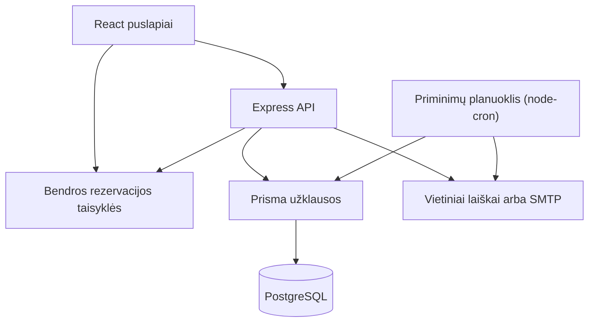
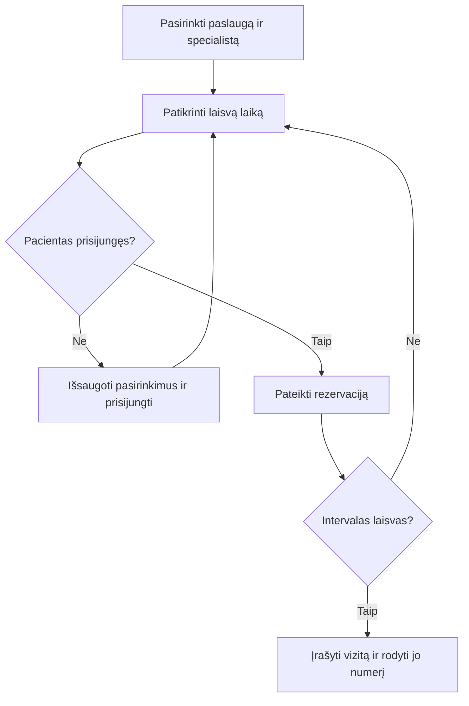
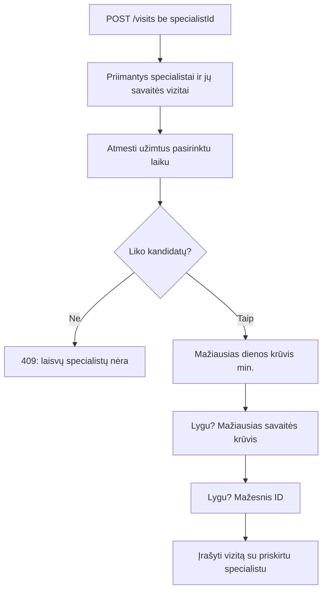
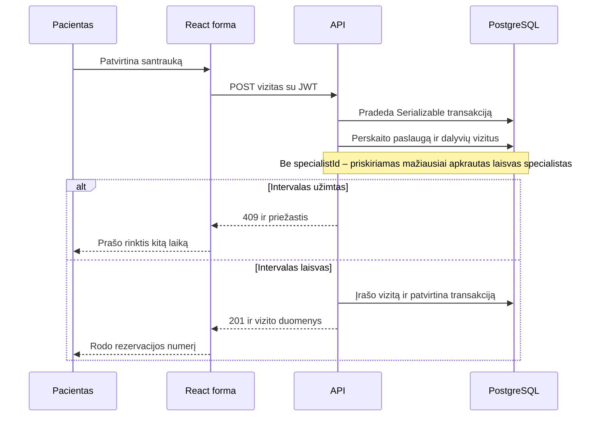
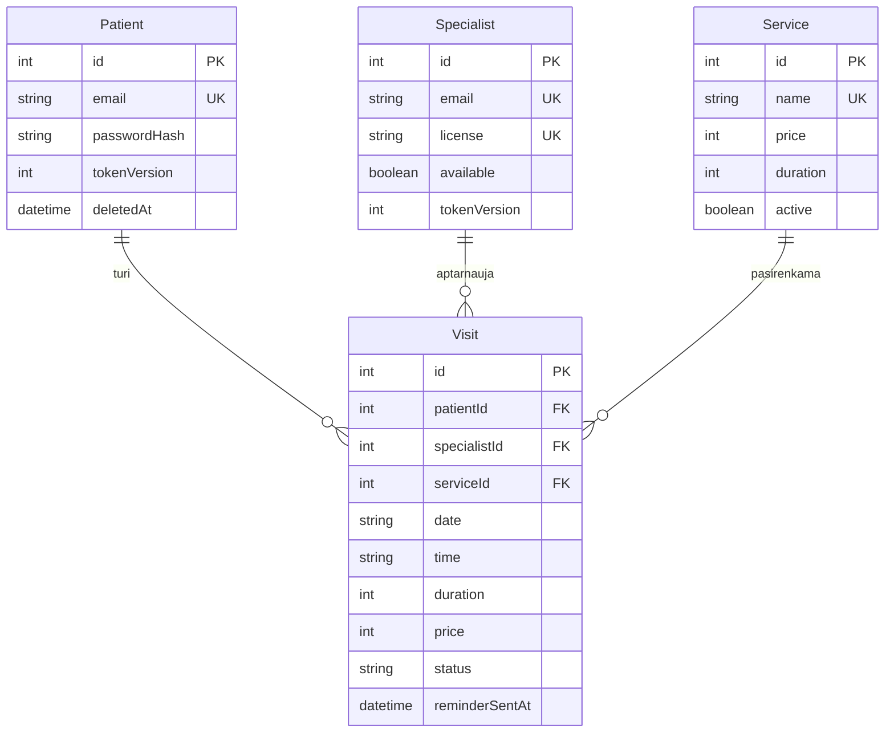

# RehaBook architektūra ir realizacija

## Komponentų atsakomybės

React komponentai valdo formų būseną ir vaizdą. `src/services/api.js` prideda sesijos JWT ir vienodai apdoroja HTTP klaidas. Express maršrutai tikrina laukus, autentifikavimo tarpinė funkcija tikrina JWT bei dabartinę paskyrą, kontroleriai įgyvendina dalykines taisykles. Prisma susieja kontrolerių užklausas su PostgreSQL lentele. Bendra `shared/booking.js` logika taikoma abiejose pusėse.

Vieši katalogai ir dienos laikų lentelės užklausa pasiekiami be prisijungimo; pastaroji su galiojančiu paciento token (pasirenkama autentifikacija `optionalAuthenticate`) papildomai pažymi laikus, persidengiančius su jo paties vizitais, bet kitų pacientų duomenų neatskleidžia. Vizito įrašymas reikalauja paciento arba administratoriaus teisės. Kūrimo režime sąsają aptarnauja Vite, o `/api` užklausas persiunčia į API; surinktą sąsają (`dist`) gali aptarnauti pats API serveris tuo pačiu adresu – statiniai failai per `express.static`, ne-`/api` keliai grąžina `index.html`, o `helmet` antraštės (įskaitant CSP) galioja ir sąsajai. Vite tarpinė prieiga padeda vietiniam paleidimui; publikuojant sistemą reikia atskirai sukonfigūruoti API maršrutizavimą ir TLS.

## Panaudos atvejai

| Aktorius | Pagrindiniai panaudos atvejai | Kontrolė |
| --- | --- | --- |
| Lankytojas | Peržiūrėti katalogus, pasirinkti laiką, sukurti paciento paskyrą | Viešas katalogas negrąžina prisijungimo laukų |
| Pacientas | Prisijungti, rezervuoti, atšaukti, peržiūrėti istoriją, atsisiųsti PDF | Tik savo duomenys |
| Specialistas | Peržiūrėti savo kalendorių, pildyti vizito aprašą, keisti slaptažodį | Vizitas priskirtas prisijungusiam specialistui |
| Administratorius | Valdyti specialistų, pacientų ir paslaugų katalogus, peržiūrėti vizitus ir suvestines | Administratoriaus rolė |

Pagrindinis panaudos atvejis „Rezervuoti vizitą“ prasideda pasirinkus paslaugą. Pacientas pasirenka konkretų specialistą arba variantą „bet kuris laisvas specialistas“; antruoju atveju sistema rodo laikus, kuriais laisvas bent vienas priimantis specialistas, o konkretų specialistą priskiria rezervacijos metu. Sistema patikrina specialistą ir pasiūlo laisvus laikus. Prieš galutinį pateikimą pacientas turi prisijungti. Sėkmės sąlyga – išsaugotas DB įrašas. Alternatyvos: klaidinga įvestis (400), nebegaliojanti sesija (401), netinkama rolė (403), užimtumo konfliktas (409) arba ryšio klaida.

## Registracijos veikla

## Darbo krūvio paskirstymas (automatinis priskyrimas)

Kai užklausoje nėra `specialistId`, `createVisit()` toje pačioje Serializable transakcijoje kviečia `assignLeastLoadedSpecialist()`: perskaito visus priimančius (`available`, nepašalintus) specialistus ir jų neatšauktus tos savaitės vizitus, o `pickLeastLoadedSpecialist()` (`shared/booking.js`) atrenka kandidatus, laisvus visai paslaugos trukmei, ir išrenka vieną pagal tris kriterijus iš eilės: mažiausias tos dienos krūvis minutėmis, mažiausias tos savaitės (pirmadienis–sekmadienis) krūvis minutėmis, mažesnis identifikatorius. Krūvis matuojamas minutėmis, o ne vizitų skaičiumi, kad 30 min. masažas ir 90 min. reabilitacija būtų vertinami pagal faktinį darbo laiką. Algoritmas yra gryna funkcija be DB priklausomybių, todėl testuojamas `tests/booking.test.js`, o visas kelias per API – `server/tests/auto-assign.test.js`. Laisvų laikų užklausa be specialisto (`GET /visits/availability?serviceId&date`) grąžina laikų sąjungą per visus kandidatus (`availableSlotsAny()`).

## Priminimai prieš vizitą

`server/src/lib/reminders.js` registruoja `node-cron` užduotį (`REMINDER_CRON`, numatyta kasdien 09:00 `Europe/Vilnius`). `sendDueReminders(date)` suranda rytojaus `laukiamas`/`patvirtintas` vizitus su `reminderSentAt IS NULL`, parengia laišką per `mailer.js` ir sąlyginiu `updateMany` pažymi siuntimo laiką, todėl operacija idempotentiška net ir paleidus du procesus. Planuoklis startuoja tik `src/index.js` (ne testuose); rankinis paleidimas – `npm run reminders`.

Sąsaja rodo visą dienos laikų lentelę: užimti laikai (specialistas užimtas bent dalį paslaugos trukmės) pritemdyti ir nepasirenkami visiems, o prisijungusio paciento laikai, persidengiantys su jo paties vizitais, pažymėti brūkšniuotu rėmeliu. Tarp laiko patikros ir rezervacijos pateikimo kitas pacientas vis tiek gali pasirinkti tą patį intervalą, todėl sąsajoje parodytas laisvas laikas nėra rezervacijos garantija. Pakartotinė patikra vykdoma serverio transakcijoje. Forma, gavusi 409, atnaujina laikų lentelę ir užimtas laikas tampa pritemdytas.

## Rezervacijos seka

Laiško parengimas pradedamas po transakcijos. SMTP atsakas nėra privaloma vizito išsaugojimo sąlyga. `serializable()` kartoja visą operaciją ne daugiau kaip tris bandymus, jei Prisma grąžina P2034. Kitos klaidos nepaslepiamos kaip konkurencijos konfliktai.

## Duomenų modelis

Tai sutrumpintas loginis modelis; visas fizinis modelis yra `server/prisma/schema.prisma` ir SQL migracijose. Vienas pacientas, specialistas ar paslauga gali turėti daug vizitų, kiekvienas vizitas turi tik po vieną šių ryšių. Kaina laikoma sveikais eurais. Vizito kainos ir trukmės kopijos užfiksuoja rezervavimo metu galiojusias reikšmes, todėl administratoriui pakeitus paslaugos kainą ar trukmę esami vizitai nesikeičia. Paslauga, turinti vizitų, nešalinama (išorinis raktas `ON DELETE RESTRICT`); vietoje to išjungiamas jos aktyvumas (`active`), ir ji dingsta iš viešo katalogo bei naujų rezervacijų. Pakeitus paslaugą būsimoje sistemos versijoje istorinio vizito trukmė neturi pasikeisti automatiškai.

`date` ir `time` saugomi tekstu (`YYYY-MM-DD`, `HH:mm`), o palyginimams laikas paverčiamas minutėmis. Tai išsaugo pirminio projekto duomenų sutartį. Serveris tikrina realias datas, darbo laiką ir laiko zoną. Perėjimas prie datos ir laiko DB tipų galėtų būti atskira vėlesnė migracija.

Dalinis unikalus indeksas apriboja specialisto, datos ir pradžios kombinaciją neatšauktiems vizitams. Jis vienas neapsaugo nuo dalinio intervalų persidengimo. Visą intervalą tikrina `createVisit` Serializable transakcijoje. Yra papildomi specialisto ir datos, paciento ir datos, būsenos ir datos indeksai. Atkūrimo raktų maišos turi unikalumo apribojimus; būsenai, kainai ir trukmei taikomi SQL CHECK apribojimai.

## Svarbiausi moduliai

| Modulis arba funkcija | Įvestis | Veiksmas ir rezultatas |
| --- | --- | --- |
| `bookingError()` | Data, laikas, trukmė, dabartinis momentas | Grąžina klaidos tekstą arba null |
| `availableSlots()` | Data, trukmė, vizitai | Grąžina pradžios laikų masyvą pagal darbo valandas |
| `availableSlotsAny()` | Data, trukmė, vizitai pagal specialistą | Laikų sąjunga, kai tinka bet kuris specialistas |
| `pickLeastLoadedSpecialist()` | Kandidatai su dienos ir savaitės vizitais, laikas, trukmė | Laisvas mažiausiai apkrautas specialistas arba null |
| `sendDueReminders()` | Data (numatyta rytoj) | Išsiunčia priminimus ir pažymi `reminderSentAt`; grąžina suvestinę |
| `services.controller` | Administratoriaus sesija, paslaugos laukai | Kuria, redaguoja, išjungia ir šalina paslaugas; viešam sąrašui atrenka tik aktyvias |
| `overlaps()` | Pradžia, trukmė, esamas vizitas | Tikrina pusiau atvirus intervalus; gretimi vizitai leidžiami |
| `createVisit()` | Validuotas JSON, sesijos tapatybė | Išsaugo serverio patikrintą vizitą arba grąžina klaidą |
| `authenticate()` | Authorization antraštė | Tikrina parašą, rolę, paskyrą ir tokenVersion |
| `resetPassword()` | Raktas, paskyros tipas, naujas slaptažodis | Atomiškai sunaudoja raktą ir panaikina ankstesnes sesijas |
| `BookingPage` | Specialistai, pradinis pasirinkimas | Valdo formos žingsnius, klaidas ir tikros rezervacijos patvirtinimą; parinktis „bet kuris laisvas specialistas“ siunčia užklausą be `specialistId` |
| `Navbar` | Dabartinis puslapis, slinkties būsena | Staliniame vaizde – nuorodų eilutė, siaurame – išskleidžiamas meniu |
| `buildVisitPdf()` | Vizitas, specialisto vardas, šrifto baitai | Sukuria jsPDF dokumentą su puslapiavimu |

## Projektiniai sprendimai ir šaltiniai

Pritaikymas mobiliesiems įrenginiams realizuotas atskiru CSS sluoksniu `src/styles/globals.css` (`@media (max-width: 768px)` ir `480px`): komponentų išvaizda lieka aprašyta inline stiliais per `theme.js`, o medijos užklausos per `rb-*` klases keičia tik išdėstymą – stulpelių skaičių, šoninės juostos virsmą viršutine juosta su slenkamu meniu, lentelių horizontalų slinkimą, modalų ir sekcijų tarpus. Staliniame vaizde šios taisyklės neveikia, todėl ankstesnė išvaizda nesikeičia. Rolių zonos kraunamos tingiai (`React.lazy` + `Suspense`), o didelės bibliotekos (recharts, react-big-calendar, jsPDF) išskaidytos į atskirus paketus (`vite.config.js` `manualChunks` pagal bibliotekų grupes; kiekvienas `vendor-*` paketas priklauso tik nuo `vendor-react`), todėl pradinis viešų puslapių JS paketas sumažėjo nuo ~983 kB iki ~73 kB.

React būsena keliama į bendrą tėvinį komponentą, kai keli puslapiai turi bendrus duomenis; atskirų formų būsena laikoma lokaliai. Tai dera su React aprašytu bendros būsenos valdymu (React, n. d., https://react.dev/learn/sharing-state-between-components).

Vite parengia naršyklei skirtą build rezultatą. Pats `dist` katalogas nepakeičia API ir DB, todėl diegimo instrukcija šias dalis aprašo atskirai (Vite, n. d., https://vite.dev/guide/build.html).

Express Router naudojamas suskirstyti maršrutus pagal dalykinę sritį. Maršruto HTTP metodas ir kelias parenka kontrolerį, o tarpinės funkcijos taiko bendras patikras (Express, n. d., https://expressjs.com/en/guide/routing/).

Zod schemos padeda deklaratyviai aprašyti formų įvestį ir jos klaidas. Serverio taisyklės būtinos nepriklausomai nuo kliento schemos, nes HTTP užklausa gali būti siunčiama tiesiogiai (Zod, n. d., https://zod.dev/basics; serverio dalies argumentas – projekto analizė).

Serializable parinktas dėl skaitymo ir įrašymo priklausomybės, kai dvi rezervacijos tikrina tą patį intervalą. PostgreSQL dokumentacija pagrindžia transakcijų izoliaciją ir visos operacijos kartojimą konflikto atveju (PostgreSQL Global Development Group, n. d., https://www.postgresql.org/docs/current/transaction-iso.html).

Sąlyginis unikalumas taikomas tik neatšauktiems vizitams. PostgreSQL dalinių indeksų mechanizmas leidžia indeksuoti pasirinktą įrašų poaibį (PostgreSQL Global Development Group, n. d., https://www.postgresql.org/docs/current/indexes-partial.html).

Atkūrimo srautas naudoja atsitiktinį, riboto galiojimo vienkartinį raktą, jo maišą DB ir vienodą atsaką užklausai. Šie sprendimai siejami su OWASP slaptažodžio atkūrimo gairėmis (OWASP Foundation, n. d., https://cheatsheetseries.owasp.org/cheatsheets/Forgot_Password_Cheat_Sheet.html).
