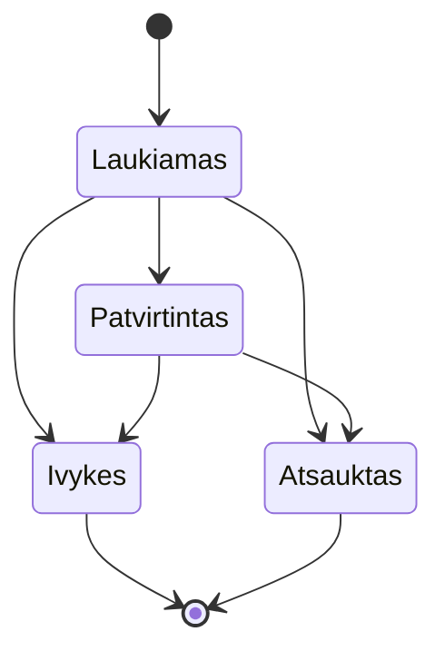

# RehaBook sistemos reikalavimai

Reikalavimai aprašo sistemos elgseną. Kliento sąsajos validacija padeda taisyti įvestį, o galutinį sprendimą priima API.

## Funkciniai reikalavimai

| ID | Pradiniai duomenys | Veiksmas ir apribojimai | Rezultatas |
| --- | --- | --- | --- |
| F01 | Paciento vardas, pavardė, el. paštas, slaptažodis | Patikrinti įvestį ir el. pašto unikalumą, sukurti bcrypt maišą | Paciento paskyra ir JWT; 400 arba 409 klaidos atveju |
| F02 | El. paštas, slaptažodis; specialistui licencija | Patikrinti paskyrą, pašalinimo ir užrakinimo būseną | Rolės JWT arba 401 / 423 |
| F03 | El. paštas ir paskyros tipas | Parengti atsitiktinį atkūrimo raktą; DB laikyti jo maišą ir galiojimo laiką | Vienodas HTTP atsakas; egzistuojančiai paskyrai parengiamas laiškas |
| F04 | Atkūrimo raktas, naujas slaptažodis, paskyros tipas | Patikrinti 30 min. galiojimą ir vienkartinį panaudojimą | Pakeistas slaptažodis, senos sesijos nebegalioja |
| F05 | Lankytojo pasirinkta paslauga ir specialistas | Parodyti katalogus; viešame specialisto atsake nerodyti prisijungimo laukų | Paslaugos kaina ir trukmė, specialisto aprašas ir prieinamumas |
| F06 | Paslaugos ID, data, neprivalomas specialisto ID; neprivalomas paciento token | Apskaičiuoti dienos pradžios laikų lentelę kas 15 min. pagal darbo valandas ir visą paslaugos trukmę: visi laikai, užimti (specialistas užimtas bent dalį trukmės), persidengiantys su prisijungusio paciento vizitais, laisvi | Lietuvos laiko juostos masyvai `slots`, `taken`, `own`, `available`; sąsajoje užimti laikai rodomi pritemdyti ir nepasirenkami |
| F07 | Paciento sesija, paslaugos ir specialisto ID, data, laikas | Transakcijoje tikrinti abiejų dalyvių užimtumą; kainą ir trukmę imti iš DB | Naujas laukiamas vizitas su ID arba 409 konfliktas |
| F08 | Prisijungimas iš registracijos santraukos | Išsaugoti pasirinkimus sessionStorage ir po prisijungimo patikrinti užimtumą iš naujo | Pacientas tęsia rezervaciją; vien prisijungimas vizito nesukuria |
| F09 | Vizito ID, paciento ar administratoriaus sesija, atšaukimo priežastis | Tikrinti nuosavybę ir aktyvią būseną | Vizitas atšauktas, jo intervalas laisvas naujai rezervacijai |
| F10 | Specialisto sesija, jo vizito ID, būsena ir aprašo laukai | Tikrinti priskyrimą specialistui ir leidžiamą būsenos perėjimą | Atnaujintas vizito aprašas; terminali būsena neaktyvuojama |
| F11 | Paciento sesija ir jo vizitas | Parodyti vizitų istoriją ir sugeneruoti PDF su įterptu Unicode šriftu | PDF su lietuviškomis raidėmis ir tekstu keliuose puslapiuose |
| F12 | Administratoriaus sesija ir katalogų įrašai | Kurti ir redaguoti pacientus bei specialistus, pasiekti sąrašus ir suvestines | Atnaujinti įrašai ir neatšauktų vizitų vertės suvestinė |
| F13 | Paslaugos ID, data ir laikas be specialisto (pasirinkimas „bet kuris laisvas specialistas“) | Toje pačioje transakcijoje iš priimančių specialistų, laisvų visai paslaugos trukmei, parinkti mažiausią tos dienos (toliau – savaitės, toliau – mažesnio ID) darbo krūvį minutėmis turintį specialistą; laisvų laikų užklausa be specialisto grąžina laikų sąjungą | Vizitas su priskirtu specialistu ir `autoAssigned: true` arba 409, jei pasirinktu laiku laisvų specialistų nėra |
| F14 | Rytojaus laukiami ir patvirtinti vizitai, kuriems priminimas dar nesiųstas | Kasdien `REMINDER_CRON` laiku (numatyta 09:00 Europe/Vilnius) parengti priminimo laišką ir pažymėti `reminderSentAt`; pakartotinis paleidimas to paties vizito nebeprimena | Priminimo laiškas pacientui (outbox arba SMTP) ir įrašytas siuntimo laikas |
| F15 | Administratoriaus sesija; paslaugos pavadinimas, kategorija, aprašas, kaina ir trukmė | Kurti ir redaguoti paslaugas, keisti jų aktyvumą; šalinti leidžiama tik paslaugą be vizitų; kainos ar trukmės pakeitimas negalioja jau rezervuotiems vizitams | Atnaujintas katalogas; neaktyvi paslauga nerodoma pacientams, laisvų laikų užklausa – 404, rezervacija – 400; šalinimas su vizitais – 409 |

F06 viešai rodo specialisto užimtumą (be paciento duomenų), o su galiojančiu paciento token papildomai pažymi jo paties vizitų laikus; konkretaus paciento ir specialisto konfliktas galutinai tikrinamas F07 transakcijoje, todėl lentelė yra pagalba pasirinkimui, o ne vienintelė apsauga. F13 įgyvendina darbo krūvio paskirstymą: pacientui nepasirinkus specialisto, sistema kreipiasi į `pickLeastLoadedSpecialist()` (`shared/booking.js`), o priskyrimas vykdomas toje pačioje Serializable transakcijoje kaip ir vizito įrašymas, todėl du vienu metu registruojami pacientai negali gauti to paties specialisto tuo pačiu laiku. F14 mažina problemos aprašyme minimų pamirštų vizitų skaičių. Paciento ID iš paciento siunčiamo JSON nepakeičia sesijoje nustatyto paciento. Administratorius kurdamas vizitą privalo pateikti paciento ID. Paslaugos pavadinimas išliko palaikomas senesniam API klientui kaip serviceId alternatyva; nauja forma visada siunčia ID.

## Nefunkciniai reikalavimai ir priėmimo kriterijai

| ID | Reikalavimas | Tikrinamas priėmimo kriterijus |
| --- | --- | --- |
| N01 | Duomenų vientisumas | Atšaukus vizitą tas pats laikas rezervuojamas; gretimi intervalai leidžiami, persidengiantys atmetami |
| N02 | Prieigos kontrolė | Pacientas nepasiekia svetimų vizitų ir administratoriaus API; specialistas redaguoja tik savo vizitus |
| N03 | Sesijų nutraukimas | Po slaptažodžio keitimo, atkūrimo ar paskyros pašalinimo ankstesnis JWT neautorizuoja užklausos |
| N04 | Įvesties kontrolė | Atmetamos neegzistuojančios datos, praeities rezervacijos, netinkamos būsenos ir bandymas pateikti kainą ar medicininius laukus kuriant vizitą |
| N05 | Aiškus grįžtamasis ryšys | Forma rodo sėkmę tik po API atsako su vizitu; ryšio klaida nepaverčiama sėkme; pateikimo metu mygtukas išjungtas |
| N06 | Atkuriamas paleidimas | Naujoje aplinkoje priklausomybės diegiamos npm ci, schema kuriama migracijomis, demonstraciniai duomenys įkeliami atskiru veiksmu |
| N07 | Lietuviškas turinys | PDF išlaiko ąčęėįšųūž ir jų didžiąsias formas; ilgo aprašo pabaiga išlieka kitame puslapyje |
| N08 | Testų izoliacija | API testai nutraukiami prieš duomenų keitimą, jei DB vardas nesibaigia _test |
| N09 | Pritaikymas mobiliesiems įrenginiams | 390 px pločio ekrane visi vieši puslapiai, registracijos žingsniai, paciento, specialisto ir administratoriaus zonos naudojami be horizontalaus puslapio slinkimo; navigacija pasiekiama per meniu mygtuką; stalinio vaizdo (> 768 px) išvaizda nesikeičia |
| N10 | Saugumo standartų taikymas | Realizuotos priemonės susietos su OWASP ASVS 4.0 ir OWASP Top 10 (2021) kategorijomis `docs/SAUGUMAS.md`; kiekviena priemonė turi nurodytą automatinį arba rankinį testą |

N01 ir F13 konkurencijos dalis patikrinta su PostgreSQL 16 ir `connection_limit=5` (žr. `docs/TESTAVIMAS.md`). N09 patikrinta Chromium 390×844 ir 1366×800 languose; kituose įrenginiuose reikalinga rankinė patikra. N06 Docker diegimas dar nepatikrintas. Maksimali naudotojų apkrova nematuota, todėl atsako trukmės garantijos nedeklaruojamos.

## Būsenų taisyklės

Diagramoje būsenų pavadinimai supaprastinti: DB saugomos reikšmės `laukiamas`, `patvirtintas`, `įvykęs`, `atšauktas`. Įvykusio vizito aprašo korekcija galima nekeičiant jo būsenos; atšauktas vizitas neredaguojamas. Prašant atšaukti būtina priežastis.
